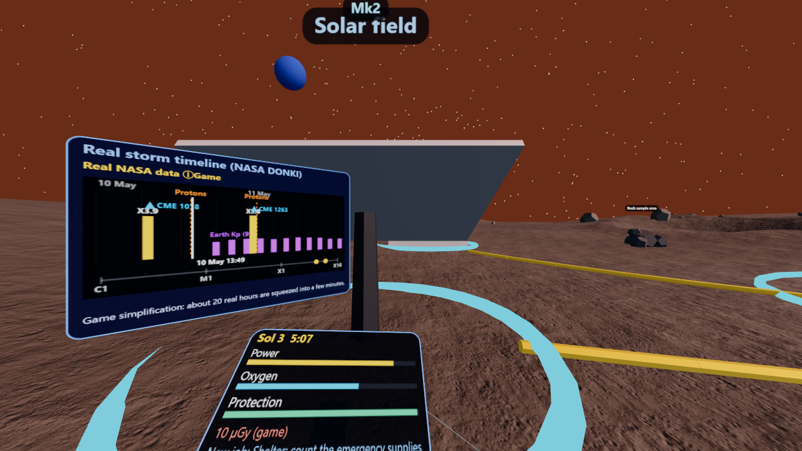
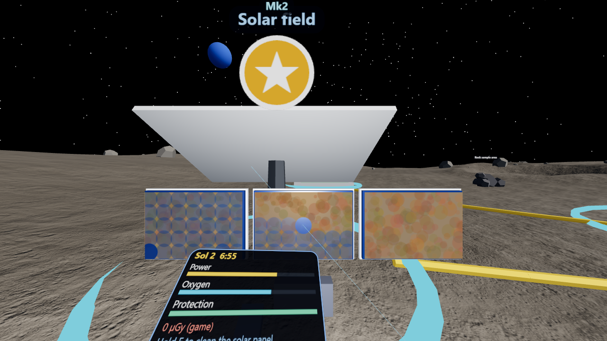
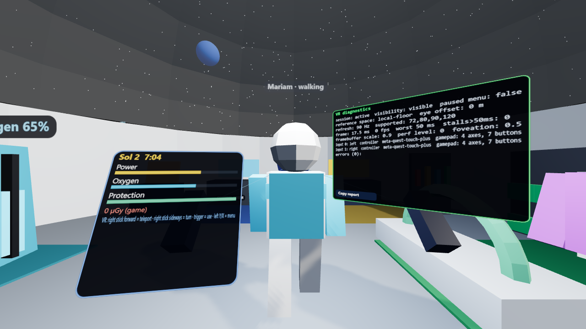

# Outpost

**Play it: https://novessa-outpost.pages.dev** (phone, laptop or VR browser; no install, no login, free).

A first-person Moon base game for ages 7 to 12, built for NASA Space Apps 2026 (challenge: Junior Astronaut Mission Trainer). You keep a crew of three alive for five game days: plan power each morning, fix what breaks, and get everyone into the shelter when a real solar storm arrives. Every choice costs something: power spent on shielding is power not spent on science. A short Mars preview (`?mars=1`) teaches why radio messages to Earth are slow.

Runs in a phone or laptop browser. No server, no logins, no network calls while playing: all NASA data is bundled as static JSON.

## What is in the game

- **A day loop** (about 2 to 3 minutes per day, 5 days): Mission Control briefing (space weather forecast, a daily power budget, a decision card), a work shift in the 3D base, a storm, and an evening report with before/after bars and a real-world note.
- **Three core meters:** Power, Oxygen and Protection (food and crew health are small extras). Floating labels over the oxygen unit and the food locker show their levels too.
- **Hands-on jobs** in a close-up view: repair a power panel, clean the solar panels, swap the water filter, tend the greenhouse. Give the crew orders, or eat a meal at the canteen (it costs food and gives health).
- **Real NASA data, labelled:** two real solar storms (DONKI), the ISS dose range for comparison (RadLab), and astronaut research cards (OSDR). A short in-engine cutscene, "A storm is forming", shows the real flare class, time and CME speed before each storm.
- **Mars preview:** a dust storm and slow radio replies from Earth (the real delay is 4 to 24 minutes one way; the game shrinks it to seconds and says so).
- **Phone friendly:** the layout fits the visible area under Safari's bars, short landscape screens get a compact layout, and two small switches (menu and tasks) hide and show the buttons. **VR mode** is built with WebXR (see below).
- **English and Arabic** (right to left).

## Screenshots (VR mode, captured in a VR emulator)


*A storm in VR: the real DONKI storm chart with its "Real NASA data" badge, and the wrist panel.*


*Cleaning the solar panels in place, halfway through.*


*The `?vrdebug=1` diagnostics panel a tester can read aloud.*

## Judges: quick demo

Open the game with `?judge=1` (or press "Quick demo (3 min)" on the title screen) for a ready base about 20 seconds before the first storm warning. Use "Reset demo" to restart it.

## How to play

A line at the top of the screen always says your next step (for example "Next job: Solar array: clean the dust. Follow the ★ marker."). The first time a storm cutscene ends, a short "What to do now" card explains the three steps.

| | Laptop | Phone |
|---|---|---|
| Move and look | WASD (Shift to run), click and move the mouse to look | Left thumb: walk. Right thumb: look |
| Do a job / use something | Hold **E** on the highlighted machine | Hold the round action button (its label changes: TALK, door, job) |
| Crew orders, menus | **Tab** (crew), **B** (build), Esc (pause) | CREW, BUILD and PAUSE buttons |
| Hide or show the buttons and the task list | not needed | The ☰ and ✔ switches on the left edge |

**On an iPhone**, Safari keeps its address bar and toolbar on screen. For the best view, tap Share, then **Add to Home Screen**, and open Outpost from the home screen icon: it then runs full screen. The game also fits the visible area when played inside Safari.

**The storm:** when the siren rings, get everyone into the shelter (the CALL CREW TO SHELTER button, or G, calls the crew). The shelter is the only place that stops the radiation. The storm chart and the dose meter (next to the real ISS range) show what the real data says.

## Options (add to the link)

| Add | What it does |
|---|---|
| `?judge=1` | Starts with a ready, upgraded base about 20 seconds before the first storm warning (the 3-minute demo). "Reset demo" restarts it. |
| `?mars=1` | The Mars preview: 4 sols, a dust storm, and radio questions to Earth with a delay. |
| `?seed=N` | Picks the two storms of a run from the real records (a number). Without it the seed is random. |
| `?classic` | Always plays the May 2024 storm pair. |
| `?vrdebug=1` | Shows the VR diagnostics panel inside a headset (see VR below). |
| `?nodash`, `?skip=150`, `?debug` | Testing aids: skip the morning screen, start 150 s in, expose debug hooks. |

## Run it

```
npm ci           # install exactly what package-lock.json says (Node 22)
npm run dev      # local development, opens on http://localhost:5173
npm run build    # production build into dist/
node scripts/simcheck.ts   # balance check of the simulation, no browser needed
npm run test:vr            # 15 VR checks in a headset emulator (needs Chrome)
npm run test:vr:hardening  # 38 more VR checks (fallbacks, input layouts, cycles, hands, stress)
npm run validate-vr        # static check of the VR code
```

Add `?skip=150` to the URL to start the mission 150 seconds in (a testing aid). Deployment steps are in [DEPLOY.md](DEPLOY.md).

## Data

The solar storm in the game is built from real NASA records. The game never calls a NASA API while it runs; the records are bundled as static JSON.

| What | Where it comes from |
|---|---|
| Storm timeline (flares, CMEs, proton events, geomagnetic storms) | NASA CCMC DONKI, Space Weather Database Of Notifications, Knowledge, Information: https://ccmc.gsfc.nasa.gov/tools/DONKI/ |
| Radiation context (quiet-day dose rate, Apollo mission doses, August 1972 estimate) | Apollo Lunar Surface Journal, "Radiation Environment": https://www.nasa.gov/wp-content/uploads/static/history/alsj/WOTM/WOTM-Radiation.html |
| Regolith shelter story | NASA Science, "How NASA Will Protect Astronauts From Space Radiation at the Moon" |

**First event: May 2024.** The solar storm from active region 13664 (this is the `?classic` pair).

| Time (UTC) | Record | DONKI id |
|---|---|---|
| 2024-05-10 06:27 | X3.9 solar flare | `2024-05-10T06:27:00-FLR-001` |
| 2024-05-10 07:12 | CME, 1018 km/s | `2024-05-10T07:12:00-CME-001` |
| 2024-05-10 13:35 | Protons above 10 MeV at GOES | `2024-05-10T13:35:00-SEP-001` |
| 2024-05-10 15:00 | Geomagnetic storm, Kp up to 9 | `2024-05-10T15:00:00-GST-001` |
| 2024-05-11 01:10 | X5.8 solar flare | `2024-05-11T01:10:00-FLR-001` |
| 2024-05-11 01:36 | CME, 1263 km/s | `2024-05-11T01:36:00-CME-001` |
| 2024-05-11 02:10 | Protons above 100 MeV at GOES | `2024-05-11T02:10:00-SEP-001` |
| 2024-05-12 21:00 | Geomagnetic storm, Kp up to 6.33 | `2024-05-12T21:00:00-GST-001` |

**Also bundled (see docs/CREDITS.md):** RadLab dose rates (`src/data/radlab.json`) for the dosimeter comparison and data cards, and OSDR study titles (`src/data/osdr.json`) for the research cards. All real data in the game carries a "Real NASA data" badge; game values carry a "Game" badge. Open the NASA Data Lab from the NASA DATA button.

**Second event: September 2017.** Flares X9.3 (2017-09-06 11:53 UTC) and X8.2 (2017-09-10 15:35 UTC), a CME of 2650 km/s, a GOES-13 proton event above 10 MeV (2017-09-10 16:45 UTC) and a geomagnetic storm of Kp 8, from the same DONKI database (`src/data/solar-event-2017.json`, downloaded 2026-11-14, no API key). Each run picks its two storms from these records with a seed (`?seed=N`); `?classic` always plays the May 2024 pair.

Four more proton records from SOHO and STEREO A, linked to the same flares, are in the JSON but are not used by the game.

Downloaded 2026-11-14 from `https://ccmc.gsfc.nasa.gov/DONKI/WS/get/{FLR,SEP,CME,GST}?startDate=2024-05-08&endDate=2024-05-12`. No API key was needed.

**Files**

- `src/data/solar-event.json`: the trimmed records. Field values are unchanged.
- `src/data/solar-event.meta.json`: source, query, download date, event ids.
- `src/data/stormTimeline.ts`: turns the records into the two in-game storms.
- `src/data/apollo.ts`: the Apollo figures and the radiation meter calibration.
- `scripts/make-solar-event.mjs`: rebuilds the JSON from raw DONKI downloads.

**How the records drive the game**

- Each proton event measured at GOES becomes one storm. Its warning starts when the linked flare began, and the radiation starts when the protons were measured.
- The real hours are compressed linearly into game seconds, so the order and the relative gaps are kept. The warning is kept between 60 and 90 game seconds, so the player always has time to react. A mission is 5 days of 132 game seconds; the storms land on day 3 and day 5.
- Storm strength follows the flare class (X5.8 is the stronger one). Storm length follows the flare's length.

**What is not NASA data**

- Storm strength and length are stand-ins. DONKI proton records give an onset time and an energy channel, not a peak level or an end time.
- The power loss during a storm, equipment failures, the meteor shower, and every supply number are game design.
- A full radiation bar stands for the August 1972 estimate (130 rem to blood-forming organs). That is a calibration choice for the story, not a dosimetry model.

**Data quality.** DONKI states that its real-time information "should be considered only as prototyping quality and in research context". NOAA Space Weather Prediction Center is the United States Government official source for space weather forecasts.

Full credits, including tools and AI use, are in [docs/CREDITS.md](docs/CREDITS.md).

## Which NASA data we used and why

- **DONKI (space weather), two real events:** May 2024 (flares up to X5.8) and September 2017 (X9.3, X8.2, Kp 8). The storms in the game are built from these records, so the warning time, class and speed are real. Each run picks storms with a seed (`?seed=N`; `?classic` is the May 2024 pair). Why: the game's main risk is real, and kids see where it came from.
- **RadLab (ISS dose rates, Moon and Mars instrument readings):** shown next to the player's storm dose so a kid can compare. Why: it puts the game numbers in a real-world scale.
- **OSDR (astronaut health studies):** six study titles shown as research cards when a task matches. Why: each chore links to real science.
- **NASA Mars facts:** gravity (0.38 of Earth), radio delay (about 4 to 24 minutes one way), dust storms and solar panels (Opportunity, 2018). Source URLs are in `src/data/facts.json`.
- **Archived, not live:** all data is bundled. The forecast screen says "Archived NASA data". Nothing is shown as live.
- **Game, not real:** power, oxygen, protection numbers, the radio delay in seconds, and all effects are labelled "Game". The Mars delay is shrunk to 20 seconds each way.

## VR / WebXR

**WebXR VR mode, hardened and tested in a VR emulator (IWER / Meta Immersive Web Emulator); not yet tested on a physical headset.** Real frame rate, comfort, controller feel and hand-tracking quality are unverified.

**Try it.** Open the game over HTTPS in the Meta Quest Browser (or in desktop Chrome with the Immersive Web Emulator extension) and press **Enter VR**. The button only appears when the browser reports immersive VR support (and is re-checked when a headset is connected). If VR cannot start, a short message says why and the game simply carries on on the screen. Start the game on the desktop first (the opening cinematic and Mission Control are skipped in VR; the evening report appears as a panel).

**Controls (controllers).**
- Teleport: push the right thumbstick forward, aim the arc (green = walkable floor, red = blocked or too far), release. Walls block teleporting.
- Snap turn: right thumbstick left or right, one 30 degree turn per flick.
- Trigger: use what the ray points at. Hold it on a machine to start a task (a progress ring fills), tap it on a door, a crew member or a console.
- Left X or Y button (A or B if you have only one controller): open the menu (crew orders, call crew to the shelter, fast-forward, Data Lab, Mission Log, exit).
- With one controller only, that controller does everything.

**Controls (hands).** Pinch to click panels and use things. To teleport, point at the floor and pinch. A grip squeeze (or the hand menu gesture) opens the menu. Only the floor pinch teleport has been run in the emulator.

**What you see.** A wrist panel on the left hand (meters, timer, dosimeter, prompt); a floating menu with large buttons; subtitles; a **live storm chart with its Real NASA data / Archived badges** during a storm; and the evening report. Text is sized for about 2 degrees of visual angle, and Arabic panels read right to left. If your head goes into a wall the view fades to black with a "step back" hint.

**Tasks in VR.** The work panel pops out at chest height and the camera never moves. Solar-panel cleaning, power-panel repair and the greenhouse are done in place with the controller ray and trigger. Other jobs use a hold-the-trigger fallback (a held trigger presses the right buttons for you).

**Comfort and performance.** Only teleport and snap turn exist (smooth movement is not built). Post-processing is switched off in VR. A frame-time controller raises foveation and reduces shadows when frames run long and relaxes them when there is room. WebXR cannot change the render resolution during a session, so the framebuffer scale is chosen at the start (0.9 by default, lower after a session that struggled; override with `?vrscale=0.8`). The session pauses the simulation and the sound when the headset reports the view is hidden or blurred.

**Diagnostics: `?vrdebug=1`.** Adds a world-space panel (off otherwise) that a tester can read aloud: session state and visibility, reference space, refresh rate, frame time and FPS, framebuffer scale and performance level, each input source (hand, controller profile, gamepad), and the last 10 errors. It has a "Copy report" button (if the browser blocks copying, read the text out loud). The menu has a switch to show or hide it.

**Known limits.** No VR on iPhone Safari (it has no WebXR). Not available in VR: building, the engineering console (upgrades), the storm quiz, the space weather console, Mission Control's power plan (the default plan is used) and the full Data Lab (a text summary is shown). The hold-the-trigger fallback for the station jobs (exercise, medical, comms and so on) is built but has not been run in the emulator.

**Proof (all in an emulator).**
- `npm run test:vr`: 15 checks (button, session, both eyes, teleport, wall block, snap turn, wrist panel, menu by ray, solar cleaning, storm, exit).
- `npm run test:vr:hardening`: 38 checks (local-floor refused so the game falls back to "local" with a 1.6 m eye height; five enter/exit cycles with no leaked listeners and no heap growth; both gamepad axis layouts; one controller, right or left; a controller disconnecting mid-task; hands only; the view hidden and blurred; head in a wall; a throttled CPU; power repair and greenhouse done with the controller; a storm and the evening report; and no-WebXR, a rejecting `isSessionSupported` and a rejecting `requestSession` all behaving safely).
- `npm run validate-vr`: a static check that fails if the VR code uses `requestAnimationFrame`, window size reads, DOM calls, pointer lock, or allocates objects in the per-frame functions.
- Screenshots are in `docs/vr-proof/` (the video is generated by the test and is not committed).

## Honest status (read this before judging)

- **Tested:** type-check, production build, the balance simulation (`node scripts/simcheck.ts`), the layout validator, 53 VR checks in a headset emulator (IWER), and phone-sized layouts in desktop Chrome (portrait, landscape, a simulated Safari toolbar).
- **Not tested:** a real iPhone or Android phone, a real VR headset (VR is emulator-tested only), real phone and headset frame rates.
- **Arabic:** drafted with AI and not yet reviewed by a native speaker; some newer screens have not been checked in right-to-left layout.
- **Offline:** the game has a web app manifest and icons (so it can be added to the home screen), but no service worker yet, so it needs a connection to load the first time.
- **Not built:** the live-data function (it would break the "no network calls while playing" rule), a helper bot, an astronaut creator.
- **Partly verified fact:** the flare scale (each letter is ten times stronger) is marked "partly verified" in `src/data/facts.json`; the game does not state it on screen.

## Deploying

The live site is built by Cloudflare Pages from the `main` branch (build `npm run build`, output `dist`, `NODE_VERSION=22`). Every push to `main` redeploys. Details and alternatives are in `DEPLOY.md`. The 30-second trailer tooling lives on the `trailer` branch (`docs/trailer/README.md` there); trailer videos are never part of the deployed site.

## Credits, licence and AI use

- **Licence:** MIT, copyright 2026 Vivan, Team Novessa: [LICENSE](LICENSE).
- **Credits** (every NASA dataset and page, asset and tool, with source URLs): [docs/CREDITS.md](docs/CREDITS.md). **Third-party licence notices** (three.js, Poly Haven CC0, NASA data, build and test tools): [docs/THIRD_PARTY_NOTICES.md](docs/THIRD_PARTY_NOTICES.md). Asset licences: [docs/ASSETS.md](docs/ASSETS.md).
- **AI use disclosure:** the code, the in-game text (English and Arabic) and the documentation were written with AI assistance (Claude Code, by Anthropic), directed, run and checked by the author. The trailer music is generated by code. There are no AI-generated images, video or voice. The Arabic text has not been reviewed by a native speaker.
